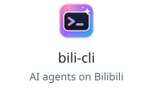
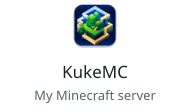
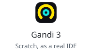

<h1 align="center">Hi, I'm kukemc 👋</h1>

  

Minecraft server owner, open-source developer and Bilibili creator from China.

  <a href="https://skillicons.dev">
    <picture>
      <source media="(prefers-color-scheme: light)" srcset="https://skillicons.dev/icons?i=py%2Cts%2Creact%2Cnextjs%2Cvue%2Cjava%2Crust%2Clinux&theme=light&perline=8" />
      
    </picture>
  </a>

 

<samp>🧑🏻‍💻 currently vibe coding with</samp>

  &nbsp;&nbsp;&nbsp;
  <picture><source media="(prefers-color-scheme: dark)" srcset="https://cdn.jsdelivr.net/npm/@lobehub/icons-static-png@1.97.1/dark/openai.png" /></picture>&nbsp;&nbsp;&nbsp;
  &nbsp;&nbsp;&nbsp;
  &nbsp;&nbsp;&nbsp;
  <picture><source media="(prefers-color-scheme: dark)" srcset="https://cdn.jsdelivr.net/npm/@lobehub/icons-static-png@1.97.1/dark/grok.png" /></picture>&nbsp;&nbsp;&nbsp;
  &nbsp;&nbsp;&nbsp;
  <picture><source media="(prefers-color-scheme: dark)" srcset="https://cdn.jsdelivr.net/npm/@lobehub/icons-static-png@1.97.1/dark/kimi.png" /></picture>&nbsp;&nbsp;&nbsp;
  &nbsp;&nbsp;&nbsp;
  &nbsp;&nbsp;&nbsp;
  

 

  
  
  
  

 

  <samp>
    <a href="https://space.bilibili.com/94782782">bilibili</a> ·
    <a href="https://live.bilibili.com/3788843">live</a> ·
    <a href="https://kuke.ink">kuke.ink</a> ·
    <a href="https://gandi.kuke.ink">gandi</a>
  </samp>

